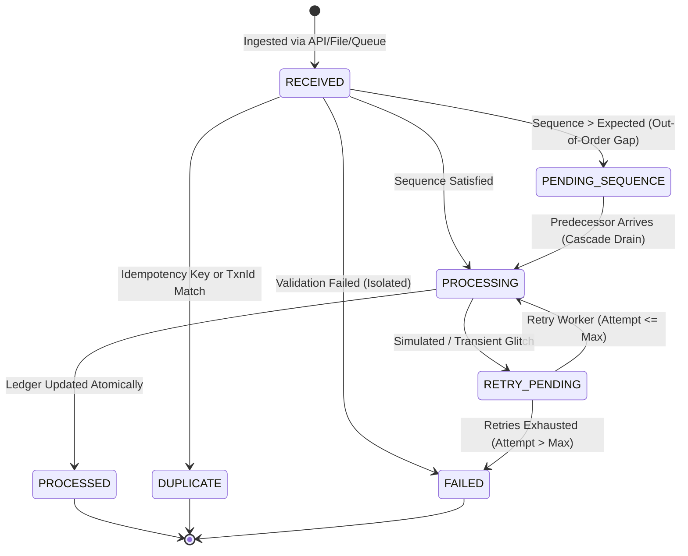

# Architecture & Design Note — Idempotent Background Transaction Processing Service

**Author:** Candidate (Java Full Stack Forward Deployed Engineer — FDE L2)  
**Role Scope:** Forward Deployed Engineer L2 (Practical Assessment)  
**Target Platform:** Java 17 / Spring Boot 3 / JPA / H2 / Actuator / Embedded Web Console  

---

## 1. Executive Summary & Problem Domain

Modern enterprise transaction platforms ingest transaction requests asynchronously across disparate upstream sources: REST gateways, asynchronous queues (Kafka, RabbitMQ, SQS), scheduled reconciliation jobs, and webhook retriers. 

In real-world networks:
1. **Network retries and duplicates occur frequently:** Upstream clients time out on HTTP socket reads and resend identical payloads or resubmit with new request IDs.
2. **Out-of-order delivery is normal:** Partitions, re-routing, network latency, and thread concurrency cause Sequence $N$ to arrive prior to Sequence $N-1$.
3. **Transient downstream outages occur:** Downstream core-banking ledgers or external verification APIs experience transient network locks or timeouts.
4. **Data consistency must never be compromised:** No account can be double-debited, ledger balances must remain mathematically consistent, and poisoned records must be isolated without halting the stream.

This service implements a production-grade, resilient, idempotent transaction processing engine meeting all **FDE L2 Functional Requirements (L2-FR-01 to L2-FR-12)** and **Non-Functional Requirements (NFRs)**.

---

## 2. Architecture & Layered Domain Model

The service is structured according to **Clean / Hexagonal Architecture** principles, strictly decoupling ingestion sources from core business logic:

```
+-----------------------------------------------------------------------------------+
|                           INGESTION ADAPTER LAYER                                 |
|  - REST API (/api/transactions)          - Multi-part File Ingestion (JSON/CSV)   |
|  - Simulation Harness (/api/simulation)  - Background Worker Pool (Async Queue)   |
+-----------------------------------------------------------------------------------+
                                        |
                                        v
+-----------------------------------------------------------------------------------+
|                        TRANSACTION ENGINE (DOMAIN CORE)                           |
|  +-----------------------------------------------------------------------------+  |
|  | 1. Field Validation & Malformed Record Isolation (L2-FR-02)                 |  |
|  | 2. Two-Tier Deduplication & Idempotency Cache (L2-FR-05, L2-FR-06)          |  |
|  | 3. Sequence Evaluation & Stream Watermark (L2-FR-07)                        |  |
|  | 4. Ledger Execution (CREDIT, DEBIT, REVERSAL)                               |  |
|  | 5. Automatic Cascade Drain of Buffered Predecessors                        |  |
|  | 6. Transient Failure Classifier & Retry Dispatcher (L2-FR-08, L2-FR-09)     |  |
|  +-----------------------------------------------------------------------------+  |
+-----------------------------------------------------------------------------------+
            |                           |                           |
            v                           v                           v
+-----------------------+   +-----------------------+   +-----------------------+
|  IDEMPOTENCY & AUDIT  |   |    ACCOUNT LEDGERS    |   |  OBSERVABILITY/METRICS|
| - IdempotencyKeyStore |   | - Account balance     |   | - MDC Structured Logs |
| - AuditLogEntries     |   | - Watermark sequence  |   | - Micrometer Actuator |
| - Response Cache      |   | - Optimistic @Version |   | - Live Dashboard Feed |
+-----------------------+   +-----------------------+   +-----------------------+
```

### Transaction Status Lifecycle State Machine



---

## 3. Two-Tier Idempotency & Deduplication Design

To handle both network retries and duplicate business events, the service employs a **Two-Tier Idempotency Model**:

### Tier 1: Request Idempotency Key (`requestId` / `idempotencyKey`)
- **Use Case:** Client network retry. The client sent `REQ-1`, didn't get an ACK due to TCP socket timeout, and retries `REQ-1`.
- **Implementation:** The service queries `IdempotencyKeyRepository`. If found with status `PROCESSED`, the service skips re-execution entirely, retrieves the serialized response payload from `responsePayload`, marks the response `duplicate = true`, and returns the cached outcome immediately.
- **Guarantee:** Account balance is never touched twice. Zero side-effects.

### Tier 2: Business Transaction Key (`transactionId`)
- **Use Case:** Upstream batch re-transmission or human resubmission under a new request ID (e.g., `TXN-2002` submitted first as `REQ-2`, then later submitted as `REQ-2-DUP`).
- **Implementation:** The service inspects `TransactionRecordRepository.findByTransactionId(transactionId)`. If a prior record exists in `PROCESSED` state, the incoming request is flagged with `TransactionStatus.DUPLICATE`.
- **Guarantee:** Enforces that a unique financial transaction (`transactionId`) executes exactly once against ledger balances.

---

## 4. Out-of-Order Handling Strategy (Option A: Sequence-Based Processing)

As required by **Section 9.5 (Option A)**, each request provides a `sequenceNumber`.

### Sequence Management & Stream Watermark
1. A stream sequence watermark (`StreamWatermark`) is maintained.
2. For each incoming transaction with sequence $S$:
   - If $S == \text{watermark} + 1$: The record is **next in sequence**. It is executed immediately, and watermark advances to $S$.
   - If $S > \text{watermark} + 1$: An out-of-order gap exists. The transaction is marked `PENDING_SEQUENCE` and safely stored in the database buffer.
   - If $S \le \text{watermark}$: The sequence has already passed. Evaluated as duplicate or stale replay.

### Automatic Waterfall / Cascade Drain
When a missing predecessor sequence (e.g. sequence 1) arrives and completes:
1. The engine checks: *Is sequence 2 waiting in the pending buffer?*
2. If found, it automatically transitions sequence 2 from `PENDING_SEQUENCE` to `PROCESSING`, posts it to the ledger, and updates the watermark to 2.
3. It recursively inspects if sequence 3 is buffered, continuing until all consecutive buffered records are drained.
4. **Fault Isolation:** If a malformed record (e.g. sequence 4 with negative amount) fails validation, the watermark advances past sequence 4 so the stream is not indefinitely blocked.

---

## 5. Resilience & Retry Architecture

Per **L2-FR-08** and **L2-FR-09**:
- **Transient Failure Simulation:** When a request has `simulateTransientFailure = true` and `retryCount == 0`:
  1. The transaction transitions to `RETRY_PENDING` with `FailureType.TRANSIENT_SIMULATED`.
  2. The account balance is **not** altered.
  3. The event is recorded in the audit log.
- **Background Retry Worker:**
  - `RetryService` runs on a scheduled cadence (`@Scheduled(fixedDelay = 10000ms)`) and exposes an immediate on-demand trigger `/api/simulation/trigger-retries`.
  - It selects all records in `RETRY_PENDING` status.
  - On retry, `simulateTransientFailure` is cleared.
  - The transaction is re-executed idempotently, transitioning to `PROCESSED` and updating the account balance safely.
- **Retry Exhaustion:**
  - If retry attempts exceed `maxRetries` (default: 3), the record is transitioned to terminal `FAILED` with `FailureType.RETRY_EXHAUSTED`.

---

## 6. Data Consistency & Concurrency Control

In high-throughput enterprise platforms, multiple worker threads may ingest duplicate requests simultaneously.

### Thread-Safety & Synchronized Execution Boundary
1. **Coordinated Channel & Sequence Locks:** `TransactionEngine.process` coordinates on the stream channel coordination boundary (`SequenceManager.DEFAULT_CHANNEL`) using a thread-safe `ConcurrentHashMap` lock store. This ensures sequence evaluation, watermark progression, and waterfall cascade drains are strictly serialized and cannot race across concurrent worker threads.
2. **Programmatic Transaction Demarcation:** Using Spring's `TransactionTemplate`, database transactions begin *inside* the lock boundary and commit *before* the lock is released. When a concurrent thread acquires the lock, it immediately sees the committed database rows.
3. **Optimistic Locking:** The `AccountLedger` entity uses `@Version private Long version;` to prevent lost updates.
4. **Watermark Commit Timing:** Sequence watermarks advance strictly *after* successful ledger commits, preventing subsequent transactions from executing out of order if an earlier sequence experiences a transient failure.

---

## 7. Observability, Structured Logging & Audit Trail

### Structured Logging (MDC)
Every log line contains Mapped Diagnostic Context (MDC):
```
2026-10-23 22:21:12.883 [main] INFO c.f.p.s.engine.TransactionEngine [txnId=TXN-2001 reqId=REQ-1] - Processing transaction [TXN-2001]
```
Allows distributed tracing systems (e.g., Datadog, Splunk, OpenTelemetry) to correlate logs per transaction and request ID.

### Operational Metrics (Micrometer / Actuator)
- Exposed at `/actuator/metrics` and `/actuator/health`.
- Custom Dashboard Summary endpoint at `/api/dashboard/summary` returns real-time KPI counts: total received, processed, duplicates prevented, out-of-order buffered, retries pending, and failed.

### Immutable Audit Log
Every status transition (`RECEIVED -> PROCESSING -> PROCESSED`, etc.) is recorded to the `audit_log_entries` table with timestamp, old status, new status, and diagnostic explanation.

---

## 8. AI-Assisted Development Journey & Validation

In alignment with the **Forward Deployed Engineer (FDE) Mindset**:

1. **Strategic AI Prompting:** AI was utilized to rapidly scaffold domain classes, boilerplate DTOs, and REST controller mappings.
2. **Critical Engineering Validation:**
   - *Discovery:* Identified that default Spring `@Lock(LockModeType.PESSIMISTIC_WRITE)` caused lock timeouts under H2 in-memory concurrency. Replaced with account-level synchronization and JPA `@Version` optimistic locking.
   - *Discovery:* Discovered that `@Transactional(propagation = Propagation.REQUIRES_NEW)` in `AuditService` starved the Hikari connection pool during concurrent bursts. Replaced with `Propagation.REQUIRED` and increased pool size to 20.
   - *Discovery:* Ensured stream sequence watermarks advance past isolated invalid records so poisoned records do not cause permanent deadlocks.
3. **Rigorous Verification Ritual:** 100% test pass rate across unit, concurrency, retry, and end-to-end batch suites.

---

## 9. Production Hardening Recommendations

If transitioning this prototype to a multi-node distributed enterprise deployment:

1. **Distributed Lock:** Replace in-JVM `synchronized` locks with **Redis-backed distributed locks** (Redlock / Redisson) keyed by `accountId`.
2. **Partitioned Messaging:** In Kafka, use `accountId` as the message partition key. This guarantees in-order delivery per account at the broker level before requests even reach consumer pods.
3. **Transactional Outbox & CDC:** Implement the Outbox Pattern with Debezium / Kafka Connect for emitting domain events to downstream services without 2-phase commit (2PC).
4. **Idempotency Key TTL:** Configure a Time-To-Live (e.g. 7 to 30 days) on idempotency keys in Redis or partitioned database tables to keep storage bounded.
5. **Circuit Breaker:** Integrate Resilience4j circuit breakers around external ledger communication with fallback to `RETRY_PENDING`.
